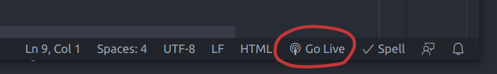

In this exercise we will build a minimal static web page to explore the main aspects of *HTML* and *CSS*.

<!--more-->

You should think about where you are going to save all this work to keep it organised.
You probably need a folder for the entire module with subfolders for each of the lab exercises and your own experiments.

```markdown {linenos=false}
 CTEC2712
   ├─ exercises
   │    ├─ folder_1
   │    └─ folder_2
   └─ experiments
        ├─ experiment_1
        └─ experiment_2
```

> Don't blindly copy these folder names.
> You should think.. use sensible names that make sense to you!


## An experiment

We are going to build a small site using the *live-server* vscode extension as our web server.

> Later, we will build our own web server using *JavaScript*.

Create a new folder for a small experiment.
Think about a naming convention that makes sense to you.
Maybe call it **live-server-experiment** or similar.

Open your new folder in VSCode and create a file **index.html**.

```markdown {linenos=false}
 CTEC2712
   └─ exercises
        └─ live-server-experiment
             └─ index.html
```

> It is crucial that you open the **folder** in VSCode, not the file.
The VSCode explorer panel should show your folder contents on the left.


Add the following, minimal content to the file.

```html
<!DOCTYPE html>
<html>
<head>
    <title>VSCode experiment</title>
</head>
<body>
    <p>This is an experiment.</p>
</body>
</html>
```

It should look something like this.



The document includes a [`<title>`](https://developer.mozilla.org/en-US/docs/Web/HTML/Element/title) in the [`<head>`](https://developer.mozilla.org/en-US/docs/Web/HTML/Element/head) element and a [paragraph](https://developer.mozilla.org/en-US/docs/Web/HTML/Element/p) in the [`<body>`](https://developer.mozilla.org/en-US/docs/Web/HTML/Element/body) of the document.


It's important that the top-level folder in the VSCode explorer window is your new folder.
This will become the root folder for the *live server* extension.
Remember, you can start the *live server* extension by clicking the *go live* button.

>
>
>You should always use this to view your site, we won't remind you again.

The site should open in your browser, looking something like this:



Admittedly its not that impressive, but we are only just beginning.

> Note that the **index.html** file is loaded automatically.
> *index.html* is a special filename that is often used as the default page which will be served when the user requests a url that points to a directory.

You should see that the `<title>` appears in the browser tab above the page, not as part of the visible page itself.
The entire page content is made up of our simple `<p>` paragraph element.

The docstring and all the other elements (`<html>`, `<head>` and `<body>`) are providing structure for the document.

Obviously, this is a very simple document.
We have to start somewhere.

## More content

We will add a hyperlink to *index.html* to allow the user to navigate to *about.html*.  

```html {hl_lines="8"}
<!DOCTYPE html>
<html>
<head>
    <title>VSCode experiment</title>
</head>
<body>
    <p>This is an experiment.</p>
    <p>See the <a href="about.html">about</a> page for more information</p>
</body>
</html>
```

We have added a second paragraph (`<p>`) containing some text and a hyperlink (an anchor tag `<a>`) pointing to another file *about.html*.
The content of the hyperlink element is the clickable text.

> `<a>` tags are *inline* elements. 
> This essentially means they are treated like text.

Now create the *about.html* file.

> The two files must be in the same folder.
>```markdown {linenos=false, hl_lines="4"}
> CTEC2712
>   └─ exercises
>        └─ vscode-experiment
>             ├─ about.html
>             └─ index.html
>```


Add the following content to *about.html*.

```html
<!DOCTYPE html>
<html>
<head>
    <title>VSCode experiment</title>
</head>
<body>
    <p>This is the about page.</p>
    <p>Go back to the <a href="index.html">home</a> page.</p>
</body>
</html>
```

It is very similar to *index.html*, but the hyperlink points back to the original *index.html* file.

The result is a minimal two-page website.



Clicking on the links allows the user to navigate between the two pages.

> Each click generates an HTTP request to the server (the *live server* extension within VSCode).
> The server responds with an HTTP response containing an HTML document which the browser parses and renders.
> You can view the requests in the *network* panel of the developer tools.

Try adding a second link to an extra page. 
Make sure your users don't get stranded on the new page (add a link back).

## Adding styles

OK, the above site is clearly very basic.

Update *index.html* as follows.

```html {hl_lines="5-10"}
<!DOCTYPE html>
<html>
<head>
    <title>VSCode experiment</title>
    <style>
        body {
            background-color: pink;
            font-size: 1.4em;
        }
    </style>
</head>
<body>
    <p>This is an experiment.</p>
    <p>See the <a href="about.html">about</a> page for more information</p>
</body>
</html>
```

We've added a `<style>` element within the `<head>` of the document.
This allows us to add *CSS rulesets* that modify the way the browser renders the content of the document.

We have added some very simple rules which will apply to the entire document `<body>`.

Do something similar to the *about.html* file.

```html {hl_lines="5-10"}
<!DOCTYPE html>
<html>
<head>
    <title>VSCode experiment</title>
    <style>
        body {
            background-color: yellow;
            font-size: 1.4em;
        }
    </style>
</head>
<body>
    <p>This is the about page.</p>
    <p>Go back to the <a href="index.html">home</a> page.</p>
</body>
</html>
```

You should notice the difference in the browser.
Each page in the site now has a distinct look.



> Try modifying any additional pages you created in similar ways.

### A CSS file

Typically, we want all the pages in our site to have common style rules.
To achieve this, we can move our style information to a CSS file and *link* to the file from all our pages.

Create a new file *style.css* and add the following content:

```css
body {
    background-color: orange;
    font-size: 1.4em;
    font-family: monospace;
}
```

Now we can remove the `<style>` elements (and all their content) from our html documents and replace them with the following line (in all files).

```html {hl_lines="5"}
<!DOCTYPE html>
<html>
<head>
    <title>VSCode experiment</title>
    <link rel="stylesheet" href="style.css">
</head>
<body>
    <p>This is an experiment.</p>
    <p>See the <a href="about.html">about</a> page for more information</p>
</body>
</html>
```

> This is a `<link>` element.
It represents a link to another file.
In this case, the **rel**(ationship) to this document is a *stylesheet*.
This tells the browser that the file will contain *CSS ruleset* information that should be applied to the document.

Now *all* our pages can have a consistent style, any changes we make to the *style.css* file will be applied to *all* our pages.



> Make sure you use the developer tools in *Chrome* to view the site from a developers perspective.

## Upgrading the website

We will end by expanding the pages into more complete documents.
Giving them a sensible structure within the `<body>` element including a shared `<header>` and `<footer>` and placing the unique page content in a `<main>` element.

Convert both files into this structure.

```html {hl_lines=["8-16", "18-21"]}
<!DOCTYPE html>
<html>
<head>
    <title>VSCode experiment</title>
    <link rel="stylesheet" href="style.css">
</head>
<body>
    <header>
        <h1>My website</h1>
        <nav>
            <a href="index.html" class="current">home</a>
            <a href="about.html">about</a>
        </nav>
    </header>
    <main>        
        <h2>This is an experiment.</h2>
        <p>See the <a href="about.html">about</a> page for more information</p>
    </main>
    <footer>
        &copy; My website developers
    </footer>
</body>
</html>
```

We've added a navigation element which will create a clickable menu in the same place on both pages.
This makes the website feel more coherent.

We can also upgrade the stylesheet to create a page layout using grid and flex.

```css
body {
    margin: 0;
    display: grid;
    grid-template-rows: auto 1fr auto;
    min-height: 100dvh;
    background-color: orange;
    font-size: 1.4em;
    font-family: monospace;
    header, main, footer {
        padding: 1rem;
    }
    header {
        background-color: orangered;
        color: white;
        display: flex;
        justify-content: space-between;
        align-items: center;

        h1 {
            margin: 0;
        }
        nav a {
            color: inherit;
            text-decoration: none;
            padding: 0.25em 0.5em;
            border-radius: 1em;
            &:hover {
                backdrop-filter: brightness(0.9);
            }
            &.current {
                backdrop-filter: brightness(0.8);
            }
        }
    }
    footer {
        font-size: 0.7em;
        text-align: right;
    }
}
```

The body now takes up 100 viewport units (the full height) and has a grid layout leaving the header and footer sized automatically and giving the main element one fraction of any extra space available.

The header has a different background colour and has a flex layout putting additional space between the heading and the nav and keeping them centrally aligned.
We also now display the navigation links differently for the current page and when they are hovered by the mouse.

The footer text has been reduced in size and aligned to the right.



One thing we should notice here is that if we add more pages to the site, they will all be able to share the CSS file but the HTML for the header and footer and the navigation menu will need to be added to each file. 
If we want to make a change to any of this common HTML (such as adding a new navigation link), we will need to make the change in every document.

> This problem will be solved when we construct our HTML dynamically on the server using JavaScript.

## Conclusions

In this exercise we have seen that we can use *VSCode* and the *Chrome* browser together as a development environment for creating *static* websites.

1. We have created very simple HTML documents with basic content using *VSCode*.
1. We have served these documents using the *live server* extension and accessed them via the *Chrome* browser.
1. We added *hyperlinks* to allow us to navigate between pages.
1. We added *CSS rulesets* to provide different styles on each page.
1. We saw how linking each page to the same *CSS* file allowed pages to share the same stylesheet.
1. We saw that more complex websites have many documents that may share common content such as headers and footers.